# Graphviz diagrams of the specs

`ksc -t graphviz` draws each spec as a diagram. Every type is a table of its fields, with
offset, size, type and id, plus its conditions, and edges link the fields to the types they
use. These diagrams are the one ksc output that **is committed** here, so they can be read on
GitHub:

| Path | What |
|---|---|
| `dot/<spec>.dot` | ksc 0.11 `-t graphviz` output, as ksc writes it |
| `svg/<spec>.svg` | `dot -Tsvg`, with a `<!-- source: <spec>.dot sha256=… -->` stamp |
| `warnings.txt` | the warnings Graphviz prints while rendering them (a baseline) |

The diagrams are derived from the specs and keep each spec's license: Apache-2.0 for the
`pcapng*` files, `linux_sll`, `ieee802_11` and `radiotap`, and CC0-1.0 for the others.

## Regenerating

```sh
python scripts/graphviz.py            # rewrite dot/, svg/ and warnings.txt, then commit them
python scripts/graphviz.py --check    # what CI runs; changes nothing
```

`dot` comes from `PATH` (or `$DOT`). On Windows without Graphviz, the script uses WSL's
(`sudo apt install graphviz`). The CI job `graphviz` installs Graphviz from apt and fails if:
- **a `.dot` is stale**: ksc's output for the current specs differs from `dot/`, or a file
  was added or removed;
- **an SVG doesn't match its `.dot`**: the sha256 stamp is wrong. The SVG bytes aren't
  compared, because they depend on the Graphviz version and the fonts;
- **a `.dot` doesn't render**;
- **the warnings changed** compared with `warnings.txt`.

If it fails, CI regenerates the diagrams and uploads them as the `graphviz-diagrams` artifact.
Both ksc's output and the SVGs are reproducible: running the script twice changes nothing, on
Windows (WSL Graphviz 2.43) and Linux alike.

## How the pcapng pieces fit

The pcapng spec is split into one file per block type, in `network/pcapng/`:

1. **[`pcapng`](#pcapng)**: a file is a list of **sections**. Each section reads its byte-order
   magic ahead to pick its byte order, then reads **blocks** until the next Section Header
   Block. Every block has the same framing: type, length, body, length again. The body's type
   is chosen by the block type, and is one of the block files below.
2. **The block files** (`pcapng_section_header_block`, `pcapng_interface_description_block`,
   …): the fields of one block type. A type in another file can't inherit the section's byte
   order, so each block file takes it as the parameter `is_le` (the diagrams don't show
   parameters; see limitation 1).
3. **[`pcapng_options`](#pcapng_options)**: the options that end most blocks. An option is a
   code, a length, a value and padding. The value is parsed in two steps:
   - `value_kind` picks `common` for the codes that mean the same in every block (comment,
     custom options), or the block's own kind otherwise;
   - that kind's `*_option_value` table names the code and picks the value type (for example
     `if_tsresol` → `option_u1`).

4. **[`pcapng_link_frame`](#pcapng_link_frame-and-the-link-layers)**: packet data stays raw bytes
   in `pcapng`, because an expression can't look up the interface a packet refers to. A reader
   passes the data and that interface's link type to `pcapng_link_frame`, which picks the link
   layer (Ethernet, 802.11, radiotap, Linux SLL, PPI).

In the diagrams, a type from another file appears as a plain stub such as
`pcapng_options__seq`; follow it to that file's diagram below.

## The diagrams

### pcapng

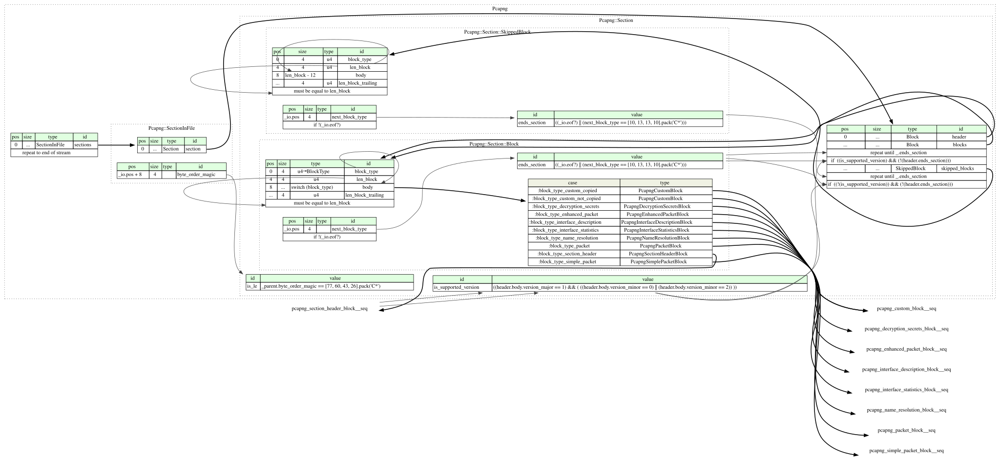

### pcapng_options

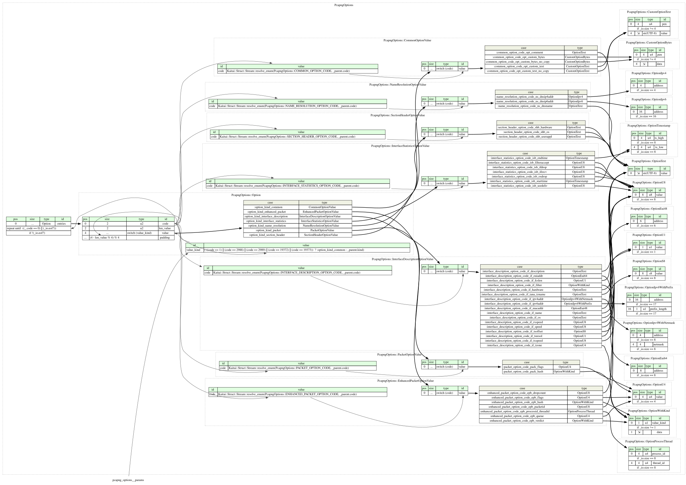

### The block files

| Block | Diagram |
|---|---|
| Section Header Block | 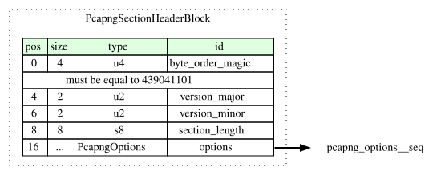 |
| Interface Description Block | 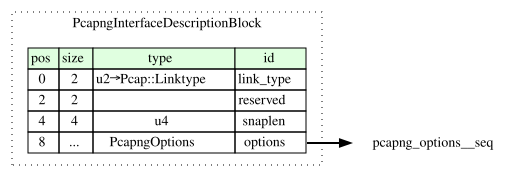 |
| Enhanced Packet Block | 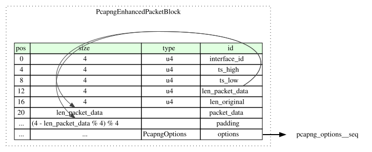 |
| Simple Packet Block | 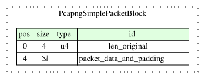 |
| Packet Block (obsolete) | 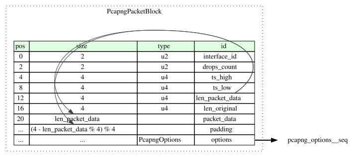 |
| Name Resolution Block | 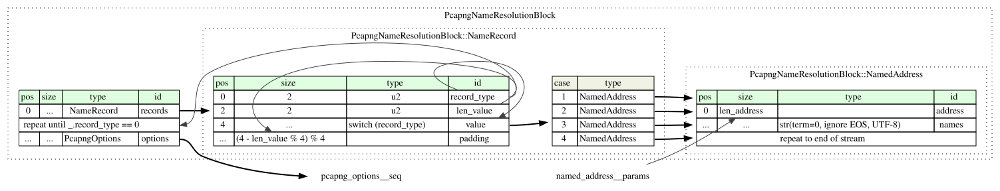 |
| Interface Statistics Block | 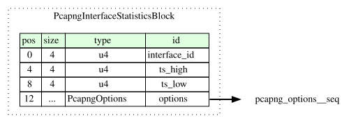 |
| Decryption Secrets Block | 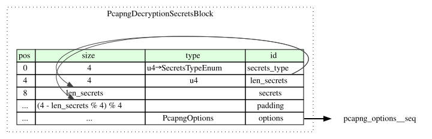 |
| Custom Block | 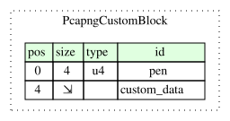 |

### pcapng_link_frame and the link layers

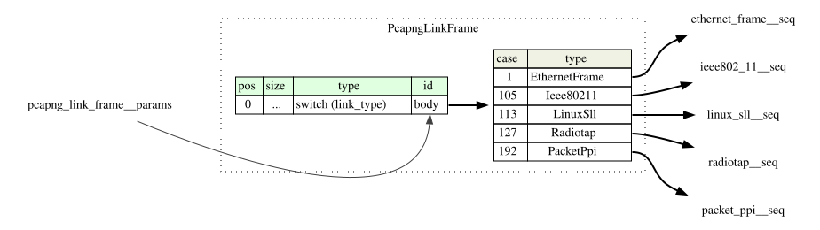

[linux_sll](svg/linux_sll.svg), [ieee802_11](svg/ieee802_11.svg), [radiotap](svg/radiotap.svg),
and the fork's patched [pcap](svg/pcap.svg) and [ethernet_frame](svg/ethernet_frame.svg) (bff8c65).

The upstream specs they import, unchanged except for `tcp_segment`'s `tcp_flags` rename:
[ipv4_packet](svg/ipv4_packet.svg), [ipv6_packet](svg/ipv6_packet.svg),
[protocol_body](svg/protocol_body.svg), [tcp_segment](svg/tcp_segment.svg),
[udp_datagram](svg/udp_datagram.svg), [icmp_packet](svg/icmp_packet.svg),
[packet_ppi](svg/packet_ppi.svg).

## What the diagrams show well

- Every user type, as a table of `pos`, `size`, `type` and `id`, nested in its parent's
  cluster.
- `if:` conditions, `repeat`/`repeat-until`, and `valid`/`contents` (shown as "must be equal to …").
- Switches, as a case → type table with an edge to each target type.
- Value instances with their expressions, and `pos:` instances with their position.
- Edges from a field to everything that depends on it (sizes, conditions, switch-on).

For a reviewer that's a quick map of a spec's structure. Splitting pcapng into one file per
block brought its main diagram from 219 KB of SVG to 55 KB, and each block's to 4-20 KB.

## Limitations (ksc 0.11)

Found by rendering all 24 specs; the evidence is in `dot/` and `warnings.txt` (31 warnings).

1. **params aren't drawn.** A type's `params:` get no node, so `pcapng_link_frame__params`,
   `named_address__params`, `pcapng_options__params`, `ieee802_11__params` and
   `protocol_body__params` are bare dangling nodes. The block files' `is_le` doesn't appear at
   all. 7 of the warnings are these ("port `<param>_type` unrecognized").
2. **Value instances have no `type` port.** An edge that starts at a value instance (where
   it's used in another expression) points at a `<name>_type` port, but the instance's table has
   only `id` and `value` cells, so Graphviz attaches the edge to the whole node. That's 22 of
   the warnings: `ends_section`, `is_supported_version`, `value_kind`, `has_llc`, `is_qos`,
   `is_snap`, `is_epd`, `ether_type`, `ihl`, `ihl_bytes` and `protocol`.
3. **Imported types are stubs.** Each spec is drawn on its own, so an imported type is a plain
   node such as `pcapng_options__seq`. Nothing links it to that spec's diagram, and edges into
   one of its fields can't find the field: `is_supported_version` reads the Section Header
   Block's version, which gives the last 2 warnings (`pcapng_section_header_block__seq`).
4. **Expressions are printed in Ruby syntax.** ksc renders graphviz expressions with its Ruby
   translator:
   - `(next_block_type == [10, 13, 13, 10].pack('C*'))`
   - `!(_io.eof?)`
   - an enum value instance as `Kaitai::Struct::Stream::resolve_enum(PcapngOptions::COMMON_OPTION_CODE, _parent.code)`
     (7 of them in `pcapng_options`)
   - switch cases over enums labelled with Ruby symbols that carry the enum's name as a prefix
     (`:block_type_enhanced_packet`, `:interface_description_option_code_if_tsresol`).
5. **Number literals lose their notation.** `valid: 0x1a2b3c4d` comes out as "must be equal to
   439041101".
6. **Case tables are sorted as strings.** Cases appear in alphabetical order of their labels, not
   in the spec's order or by value: the Interface Description options run `if_description,
   if_euiaddr, if_fcslen, if_filter, …`, not by option code.
7. **Enums aren't drawn.** A field shows `u4→BlockType`, but there's no table of the enum's
   values or names anywhere.
8. **Calculated endianness isn't shown.** `meta/endian: switch-on` (the section's byte order,
   and the block files' `is_le`) doesn't appear anywhere.
9. **No documentation.** `doc` and `doc-ref` aren't used. There are no tooltips and no links,
   though Graphviz's `tooltip` and `URL` attributes work in SVG.

## Possible improvements

**In ksc's graphviz backend**, one for each limitation above:
1. Draw a params table per type, with ports, as for `seq`.
2. Give instance tables a type cell (or point those edges at the `value` cell).
3. Emit `URL="<import>.svg"` on imported-type nodes, with ports for their fields, or add an
   option to draw imported specs as clusters in the same graph.
4. Use a target-neutral expression printer: ksc's own `.ksy` expression syntax would read best.
5. Keep each literal's source form (hex stays hex).
6. Keep the cases in the spec's order (or sort integer keys numerically).
7. Draw enums as tables, with an edge from each enum-typed field.
8. Show `meta/endian`, including a `switch-on`, in the type's header.
9. Put `doc` in `tooltip` and `doc-ref` in `URL`.

These would also improve [formats.kaitai.io](https://formats.kaitai.io/): upstream's
`_build/build-html` embeds the same graphviz diagrams in each format's page.

**Here, if wanted later:** a post-processing step on `dot/` could add 3 (links between the SVGs),
6 (case order) and 9 (tooltips from the `.ksy`). For now the diagrams are committed as ksc makes
them, so they show what upstream would show.

**In the specs:** splitting pcapng into one file per block, and replacing its one 45-case
`value_key` switch with a named switch per kind of block, is what made its diagrams readable.
