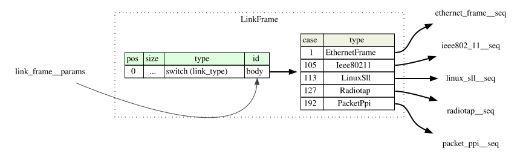
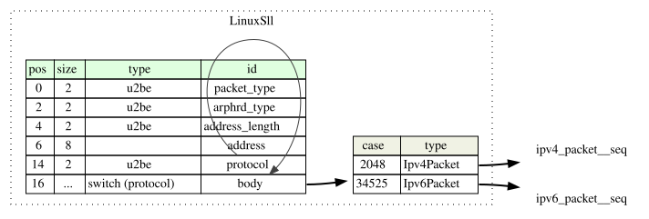
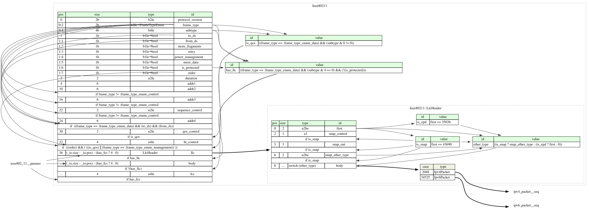
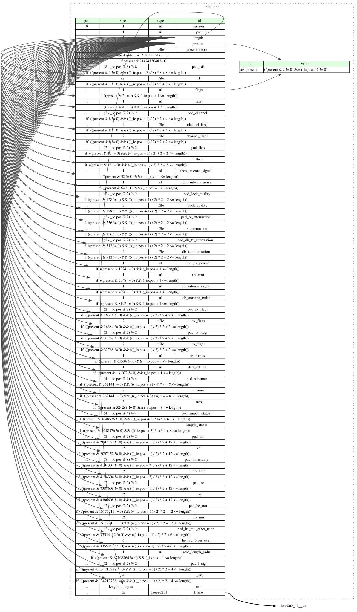
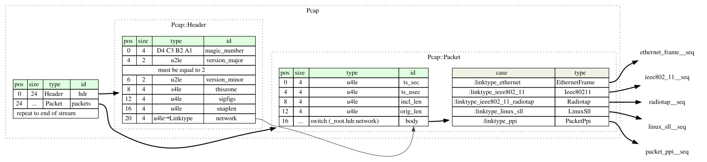
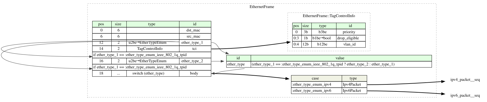

# Graphviz diagrams of the specs

`ksc -t graphviz` draws each spec as a diagram. Every type is a table of its fields, with
offset, size, type and id, plus its conditions, and edges link the fields to the types they
use. These diagrams are the one ksc output that **is committed** here, so they can be read on
GitHub:

| Path | What |
|---|---|
| `dot/<spec>.dot` | ksc 0.11 `-t graphviz` output, as ksc writes it |
| `svg/<spec>.svg` | `dot -Tsvg`, with a `<!-- source: <spec>.dot sha256=… -->` stamp |
| `warnings.txt` | the warnings Graphviz prints while rendering them (a baseline) |

The diagrams are derived from the specs and keep each spec's license: Apache-2.0 for `pcapng`,
`link_frame`, `linux_sll`, `ieee802_11` and `radiotap`, and CC0-1.0 for the others.

## Regenerating

```sh
python scripts/graphviz.py            # rewrite dot/, svg/ and warnings.txt, then commit them
python scripts/graphviz.py --check    # what CI runs; changes nothing
```

`dot` comes from `PATH` (or `$DOT`). On Windows without Graphviz, the script uses WSL's
(`sudo apt install graphviz`). The CI job `graphviz` installs Graphviz from apt and fails if:
- **a `.dot` is stale**: ksc's output for the current specs differs from `dot/`, or a file
  was added or removed;
- **an SVG doesn't match its `.dot`**: the sha256 stamp is wrong. The SVG bytes aren't
  compared, because they depend on the Graphviz version and the fonts;
- **a `.dot` doesn't render**;
- **the warnings changed** compared with `warnings.txt`.

If it fails, CI regenerates the diagrams and uploads them as the `graphviz-diagrams` artifact.
Both ksc's output and the SVGs are reproducible: running the script twice changes nothing, on
Windows (WSL Graphviz 2.43) and Linux alike.

## The diagrams

The fork's own specs, and the two it patches:

### pcapng


### link_frame



### linux_sll



### ieee802_11



### radiotap



### pcap (patched, bff8c65)



### ethernet_frame (patched, bff8c65)



The upstream specs they import, unchanged except for `tcp_segment`'s `tcp_flags` rename:
[ipv4_packet](svg/ipv4_packet.svg), [ipv6_packet](svg/ipv6_packet.svg),
[protocol_body](svg/protocol_body.svg), [tcp_segment](svg/tcp_segment.svg),
[udp_datagram](svg/udp_datagram.svg), [icmp_packet](svg/icmp_packet.svg),
[packet_ppi](svg/packet_ppi.svg).

## What the diagrams show well

- Every user type, as a table of `pos`, `size`, `type` and `id`, nested in its parent's
  cluster.
- `if:` conditions, `repeat`/`repeat-until`, and `valid`/`contents` (shown as "must be equal to …").
- Switches, as a case → type table with an edge to each target type.
- Value instances with their expressions, and `pos:` instances with their position.
- Edges from a field to everything that depends on it (sizes, conditions, switch-on).

For a reviewer that's a quick map of a spec's structure. `pcapng`'s has 104 edges.

## Limitations (ksc 0.11)

Found by rendering all 14 specs; the evidence is in `dot/` and `warnings.txt`.

1. **params aren't drawn.** A type's `params:` get no node, so `link_frame__params`,
   `named_address__params`, `option__params`, `ieee802_11__params` and `protocol_body__params`
   are bare dangling nodes. 7 of the 29 warnings in `warnings.txt` are these ("port
   `<param>_type` unrecognized").
2. **Value instances have no `type` port.** An edge that starts at a value instance (where
   it's used in another expression) points at a `<name>_type` port, but the instance's table has
   only `id` and `value` cells, so Graphviz attaches the edge to the whole node. That's the other
   22 warnings: `ends_section`, `is_supported_version`, `value_key`, `has_llc`, `is_qos`,
   `is_snap`, `is_epd`, `ether_type`, `ihl`, `ihl_bytes` and `protocol`.
3. **Imported types are stubs.** Each spec is drawn on its own, so an imported type is a plain
   node such as `ethernet_frame__seq`. Nothing links it to that spec's diagram.
4. **Expressions are printed in Ruby syntax.** ksc renders graphviz expressions with its Ruby
   translator:
   - `(next_block_type == [10, 13, 13, 10].pack('C*'))`
   - `!(_io.eof?)`
   - `Pcapng::I__OPTION_KIND[kind] || kind`
   - switch cases over enums labelled with Ruby symbols that carry the enum's name as a prefix
     (`:block_type_enhanced_packet`, `:ether_type_enum_ieee_802_1q_tpid`).
5. **Number literals lose their notation.** The spec's hex switch keys (`0x10002`) come out as
   decimal (`65538`), and so does `valid: 0x1a2b3c4d` ("must be equal to 439041101").
6. **Case tables are sorted as strings.** `option`'s cases run `1, 131074, …, 19372, 196610, …,
   2988`.
7. **Enums aren't drawn.** A field shows `u4→BlockType`, but there's no table of the enum's
   values or names anywhere.
8. **Calculated endianness isn't shown.** `meta/endian: switch-on` (pcapng's per-section byte
   order) doesn't appear, and neither does which types inherit it.
9. **No documentation.** `doc` and `doc-ref` aren't used. There are no tooltips and no links,
   though Graphviz's `tooltip` and `URL` attributes work in SVG.

## Possible improvements

**In ksc's graphviz backend**, one for each limitation above:
1. Draw a params table per type, with ports, as for `seq`.
2. Give instance tables a type cell (or point those edges at the `value` cell).
3. Emit `URL="<import>.svg"` on imported-type nodes, or add an option to draw imported specs as
   clusters in the same graph.
4. Use a target-neutral expression printer: ksc's own `.ksy` expression syntax would read best.
5. Keep each literal's source form (hex stays hex).
6. Sort case keys numerically when they're integers.
7. Draw enums as tables, with an edge from each enum-typed field.
8. Show `meta/endian`, including a `switch-on`, in the type's header.
9. Put `doc` in `tooltip` and `doc-ref` in `URL`.

These would also improve [formats.kaitai.io](https://formats.kaitai.io/): upstream's
`_build/build-html` embeds the same graphviz diagrams in each format's page.

**Here, if wanted later:** a post-processing step on `dot/` could add 3 (links between the SVGs),
6 (numeric case order) and 9 (tooltips from the `.ksy`). For now the diagrams are committed as
ksc makes them, so they show what upstream would show.

**In the specs:** nothing needed. 5 and 6 come from ksc, not the spec: `pcapng.ksy` writes its
option keys in hex on purpose (kind in the upper 16 bits, code in the lower 16).
